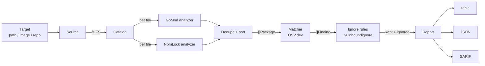
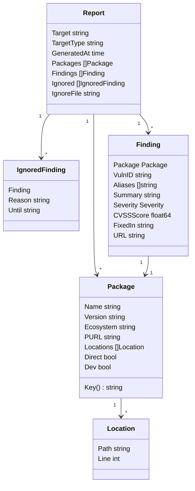
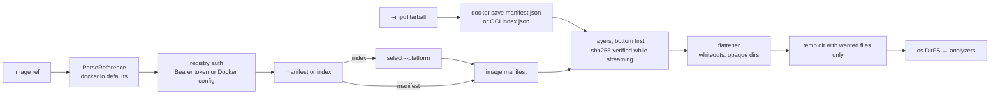
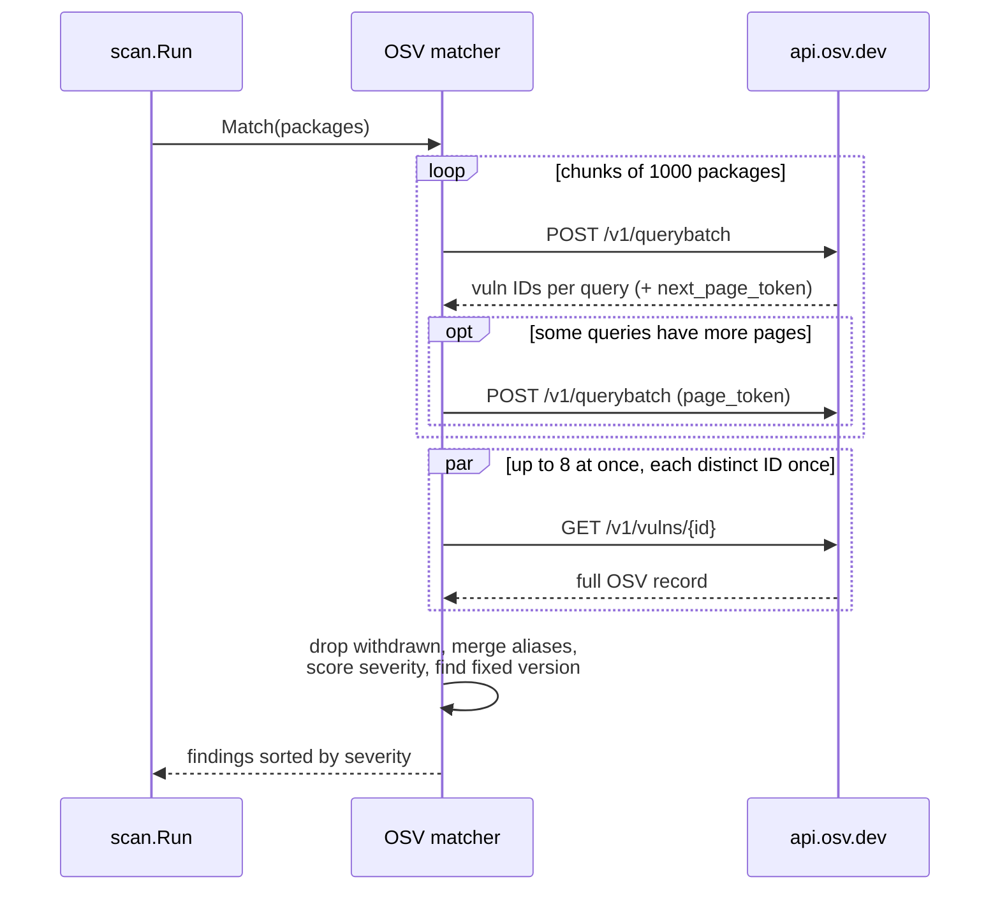

# Architecture

This document describes how vulnhound is structured, why it is structured
that way, and where new features plug in. For how a scan runs step by step
and how to work on the code, see [workflow.md](workflow.md).

## Design goals

1. **Single static binary.** No Docker daemon, no CGO, no runtime
   dependencies. Every library choice is checked against this.
2. **Collecting is separate from checking.** Finding *what is installed* and
   deciding *whether it is vulnerable* are separate stages. Every target type
   produces the same list of packages, and one matcher checks that list.
3. **One bad input never aborts a scan.** A malformed lockfile is logged and
   skipped. Only failures that make the whole result untrustworthy, such as
   the vulnerability source being unreachable, are fatal.
4. **Deterministic output.** The same input always produces the same report,
   in the same order, so reports can be diffed and tested with golden files.

## Pipeline



| Stage | Package | Input | Output |
|-------|---------|-------|--------|
| Source | `internal/source` | target reference | `*source.Target` (an `fs.FS` + name/type) |
| Catalog | `internal/analyzer` | `fs.FS` + analyzers | `[]types.Package`, deduplicated and sorted |
| Match | `internal/matcher` | `[]types.Package` | `[]types.Finding`, sorted by severity |
| Ignore | `internal/ignore` | rules + `[]types.Finding` | kept findings, `[]types.IgnoredFinding` |
| Report | `internal/report` | `*types.Report` | bytes in the chosen format |
| Orchestration | `internal/scan` | `scan.Options` | `*types.Report` |
| CLI | `cmd/vulnhound` | flags and args | exit code |

`internal/scan.Run` is the only place that knows the order of the stages.
The CLI only parses flags, builds `scan.Options`, renders the report, and
maps errors to exit codes.

## Package layout

```
vulnhound/
├── cmd/vulnhound/        CLI: main.go (exit codes), root.go, scan.go
├── internal/
│   ├── source/           Source interface, Dir implementation
│   ├── analyzer/         Analyzer interface, Catalog, gomod.go, npm.go
│   ├── matcher/          Matcher interface, OSV API and offline matchers, CVSS v3 scoring
│   ├── osvdb/            local copy of the OSV database for --offline
│   ├── ignore/           .vulnhoundignore parsing and matching
│   ├── purl/             Package URL builder
│   ├── report/           table, JSON, and SARIF renderers; color theme
│   ├── scan/             pipeline orchestration
│   └── version/          per-ecosystem version comparison
└── pkg/types/            Package, Finding, Severity, Report
```

Everything except `pkg/types` is under `internal/`, so it can be refactored
freely. `pkg/types` is the stable public data model: it is what JSON reports
contain and what other Go programs would import.

## Data model

Defined in [`pkg/types/types.go`](../pkg/types/types.go).



Notes on the fields:

- **`Ecosystem`** uses OSV's ecosystem names (`Go`, `npm`), so packages can be
  sent to OSV unchanged. OS packages will use OSV's release-qualified names
  such as `Debian:12` and `Alpine:v3.19`.
- **`Key()`** is `ecosystem|name|version`. Two packages with the same key are
  the same package, wherever they were found. It is used for deduplication.
- **`PURL`** is the cross-tool identifier (e.g. `pkg:npm/%40babel/core@7.20.0`).
  SBOM export will need it.
- **`Locations`** lists every file the package was found in, with the
  1-based line that declares it (`0`/omitted when unknown). In a monorepo
  one package often appears in several lockfiles. SARIF creates one alert per
  location, pointing at that line.
- **`Direct`** is true if the package is a direct dependency in *any*
  location. **`Dev`** is true only if it is dev-only in *every* location.
  A package that is a dev dependency in one project but a runtime dependency
  in another is therefore treated as a runtime dependency.
- **`SourceName` / `SourceVersion`** are set for distro packages: Debian,
  Ubuntu, and Alpine publish advisories per source package (`openssl`),
  not per binary package (`libssl3`). The matcher queries OSV with
  `AdvisoryName()` / `AdvisoryVersion()`, and packages that share a source
  share one query.
- **`Severity`** is an ordered integer (`UNKNOWN < LOW < MEDIUM < HIGH <
  CRITICAL`), so `--fail-on` is a simple comparison. It is written to JSON
  as a string.

## Components

### Source

```go
type Source interface {
    Open(ctx context.Context) (*Target, error)
}

type Target struct {
    Name string  // absolute path, image reference, repo URL
    Type string  // "dir", later "image", "repo"
    FS   fs.FS
    // Close() releases temp dirs, extracted layers, clones
}
```

The key decision is that **every source exposes an `fs.FS`**. Analyzers read
files through `fs.FS` only, so they never know whether the files came from a
directory, a Git clone, or a flattened container image. They can also be
tested with an in-memory `fstest.MapFS` instead of real files.

Implemented: `Dir` (wraps `os.DirFS`), and `image.Remote` / `image.Archive`
in `internal/source/image`. Planned: `Repo` (clone into a temp dir).

#### Images

Image support uses only the standard library, so the binary keeps its
single-file, no-runtime design.



| Piece | File | Notes |
|-------|------|-------|
| Reference parsing | `reference.go` | `nginx` → `docker.io/library/nginx:latest`; registry hosts are first components with `.` or `:` or `localhost`; digests are validated |
| Registry client | `registry.go` | OCI Distribution API. On `401` it answers the `Bearer` challenge with a pull-scoped token (anonymous, or using inline credentials from the Docker config). Manifests fetched by digest are verified; blobs are hashed while streaming and fail at EOF on mismatch |
| Archives | `archive.go` | `docker save` (`manifest.json`) and OCI layouts (`index.json`). Entries are indexed once and read in place with `io.SectionReader`; a gzipped tarball is decompressed to a temp file first |
| Layers | `manifest.go` | Compression is detected from magic bytes; gzip and uncompressed tar are supported, zstd is rejected with a clear error |
| Flattening | `flatten.go` | Applies layers in order. `.wh.NAME` deletes a lower-layer path, `.wh..wh..opq` empties a directory. Only files the analyzers want (`analyzer.Selector`) are written. Entry names are cleaned as absolute paths, so `..` cannot escape the temp dir. Symlinks and hard links are never created: they are resolved inside the image after all layers and the target's content is copied, so a link cannot reach host files |

The temporary directory is removed by `Target.Close`.

### Analyzers and Catalog

```go
type Analyzer interface {
    Name() string
    Match(path string) bool
    Analyze(ctx context.Context, fsys fs.FS, path string) ([]types.Package, error)
}
```

`Analyze` receives the whole `fs.FS`, not just one file's reader. Some
formats need more than one file: the npm v1 lockfile analyzer reads the
sibling `package.json` to find direct dependencies, and OS analyzers will
need `/etc/os-release` to know the distro version.

`Catalog` runs in two phases:

1. **Walk** the filesystem once, skipping `.git`, `node_modules`, `vendor`,
   and anything matching `Options.Exclude`. A pattern without `/` matches a
   file or directory name at any depth; one with `/` matches the path from
   the scan root (`path.Match` syntax). For each regular file, ask every
   analyzer whether it matches, and record a job for each match.
2. **Analyze** the jobs in parallel with an `errgroup`, limited to
   `GOMAXPROCS`. An analyzer error is logged as a warning and the job is
   dropped; only context cancellation stops the run.

Results are then merged by `Package.Key()` and sorted by ecosystem, name,
and version.

Analyzers are grouped by target: `analyzer.Default()` (manifests, for
`scan dir`) and `analyzer.ForImage()` (adds `Dpkg`, `Apk`, `GoBinary`).
Analyzers that select files by type rather than name implement
`FileMatcher`, which `Catalog` calls with the file's mode and size; that is
how `GoBinary` finds executables without reading every file.

| Analyzer | File | Behaviour |
|----------|------|-----------|
| `GoMod` | `go.mod` | Reads `require` lines and applies `replace` directives. Local-path replacements are skipped because there is nothing to look up. Uses `modfile.Parse`, not `ParseLax`, because `ParseLax` drops `replace`. `go.sum` is deliberately ignored because it lists versions that are not part of the build. |
| `NpmLock` | `package-lock.json` | v2/v3: reads the flat `packages` map, derives the name from the last `node_modules/` segment (or the `name` field for aliases), and skips the root, workspace members, and links. v1: walks the nested `dependencies` tree and decodes `npm:real@version` aliases. Non-registry versions (`git+ssh:`, `file:`) are skipped. |
| `Dpkg` | `var/lib/dpkg/status`, `var/lib/dpkg/status.d/*` | Debian control paragraphs; skips packages whose `Status` is not `installed` (distroless `status.d` files have no status and count as installed). `Source: openssl (3.0.11-1)` sets `SourceName`/`SourceVersion`. The ecosystem (`Debian:12`, `Ubuntu:22.04:LTS`) comes from `os-release` |
| `Apk` | `lib/apk/db/installed` | Blocks of `P:` name, `V:` version, `o:` origin (the source package). Ecosystem `Alpine:vMAJOR.MINOR` from `os-release` |
| `GoBinary` | executables of 64 KiB–512 MiB (`FileMatcher`) | `debug/buildinfo` reads the embedded main module, dependencies (following `replace`), and Go version, reported as `stdlib`. Non-Go executables are skipped silently |

### Matcher

```go
type Matcher interface {
    Match(ctx context.Context, pkgs []types.Package) ([]types.Finding, error)
}
```

`OSV` is the only implementation today. A match runs in four steps:



1. **Query IDs.** `querybatch` takes at most 1,000 queries per request and
   returns only vulnerability IDs. Queries with a `next_page_token` are
   re-sent until exhausted.
2. **Fetch details.** Each distinct ID is fetched once from `/v1/vulns/{id}`,
   8 requests at a time. Any failure here fails the scan, because a partial
   result would silently under-report.
3. **Merge aliases.** For each package, records that list each other as
   aliases are grouped (e.g. `GO-2023-1737` and `GHSA-2c4m-59x9-fr2g`). Each
   group becomes one finding. The representative ID is the record with the
   highest severity, ties broken alphabetically; summary and fixed version are
   borrowed from other records in the group when the representative lacks
   them.
4. **Severity and fix.** See below.

**Severity** is taken from the first of these that exists:

1. A `CVSS_V3` vector, scored with the CVSS v3.1 base formula in
   [`cvss.go`](../internal/matcher/cvss.go) (verified against reference
   vectors in tests).
2. The record's `database_specific.severity` (GitHub advisories; `MODERATE`
   maps to `MEDIUM`).
3. A per-package `database_specific` or `ecosystem_specific` severity.

Otherwise it is `UNKNOWN`. This is common for Go vulnerability database
entries with no GitHub advisory alias. CVSS v4 vectors are not scored yet.

**Fixed version** is the `fixed` event that closes the affected range
containing the installed version. Versions are compared per ecosystem by
`internal/version`: Go and npm with `golang.org/x/mod/semver` after
normalising to `vX.Y.Z`, Debian and Ubuntu with dpkg's ordering (epochs,
`~` sorting before everything), and Alpine with apk's ordering (`_rc`,
`_p` suffixes, `-rN` revisions). When versions can't
be compared, or no range contains the version, every fixed version is listed
instead (`1.2.0, 2.0.5`). Go fixed versions are shown with the `v` prefix
that `go.mod` uses, although OSV stores them without it.

**HTTP behaviour:** 30-second timeout per request, `User-Agent:
vulnhound/<version>`, and up to 3 attempts on HTTP 429, 5xx, or network
errors, waiting 1 s and then 2 s. Other 4xx responses fail immediately.

#### Offline matching

`matcher.Offline` (with `--offline`) reads records from `internal/osvdb`
instead of the API and decides itself which ones apply, following the
[OSV evaluation rules](https://ossf.github.io/osv-schema/#evaluation):

1. A record applies when one of its `affected` entries names the package's
   ecosystem and advisory name, and the advisory version is either in its
   `versions` list or inside a `SEMVER` or `ECOSYSTEM` range.
2. A range is evaluated by sorting its events by version (`introduced: 0`
   first) and walking them: `introduced` at or below the version opens the
   range, `fixed` at or below it closes it, `last_affected` below it closes
   it. `GIT` ranges are ignored. A range with versions `internal/version`
   cannot compare is treated as not affecting; the `versions` list still
   applies.
3. The matching records go through the same `findingsFor` as online
   results, so alias merging, severity, and fixed versions are identical.

Packages whose ecosystem dump is missing fail the scan with the exact
`vulnhound db update ...` command to run, rather than silently reporting
nothing. A dump older than 7 days produces a warning.

`internal/osvdb` stores one dump per base ecosystem (`Debian` covers
`Debian:11`, `Debian:12`, ...):

| File | Contents |
|------|----------|
| `<Eco>/all.zip` | The OSV dump from `osv-vulnerabilities.storage.googleapis.com`, one JSON record per entry |
| `<Eco>/index.json` | `"<ecosystem>\t<name>"` → zip entries that list that package, built once per update; withdrawn records are left out |
| `<Eco>/meta.json` | ETag, update time, size, record count |

`Update` sends `If-None-Match` with the stored ETag, downloads to a temp
file while hashing it, compares the MD5 with Cloud Storage's
`x-goog-hash` header, builds the index, and only then renames the new
files into place, so a failed or interrupted update keeps the previous
copy. A scan opens the zip once and reads only the entries the index
lists for its packages.

### Report

`report.Write(w, format, report, opts)` renders `table` or `json`.

- **table** ([`table.go`](../internal/report/table.go)): a two-line header
  with package and severity counts, then findings **grouped by package**.
  Groups are ordered by their most severe finding, then by number of
  findings. Each group header shows the best upgrade: the highest single
  fixed version among its findings, compared with `internal/version`, and
  how many findings it fixes. A footer totals what upgrading would fix.
- **json:** the `types.Report` struct, indented. Empty lists are `[]`, never
  `null`. Never colored.

Table rendering does not use `text/tabwriter`. Column widths are measured
on the plain text, and color codes and padding are added afterwards, so any
color theme keeps the columns aligned. A test strips the codes from colored
output and checks it is identical to plain output.

`report.Options` carries what the CLI decided about the output stream:

| Option | Set when | Effect |
|--------|----------|--------|
| `Color` | `--color always`, or `auto` on a terminal without `NO_COLOR` / `TERM=dumb` | ANSI SGR colors from the `Theme` |
| `Hyperlinks` | colors are on **and** stdout is a terminal | Vulnerability IDs become OSC 8 links to osv.dev |
| `Width` | stdout is a terminal | Summaries are cut to fit; dropped when under 10 columns remain |
| `Theme` | colors are on | Defaults from [`theme.go`](../internal/report/theme.go) with `VULNHOUND_COLORS` overrides |

Files and pipes get no hyperlinks and no width limit even with
`--color always`, since they have no width and may not understand OSC 8.

### CLI and exit codes

| Code | Constant | Meaning |
|------|----------|---------|
| 0 | `exitOK` | Scan succeeded, nothing at or above `--fail-on` |
| 1 | `exitFindings` | Scan succeeded, policy failed |
| 2 | `exitError` | Anything else: bad flags, unreadable target, OSV failure |

The policy failure is returned as the sentinel `errFindings` so `main` can
tell it apart from real errors. Flags are validated before any work starts.
`Ctrl-C` cancels the context, which stops the walk, the analyzers, and
in-flight HTTP requests.

## Concurrency

| Where | Mechanism | Limit |
|-------|-----------|-------|
| Analyzing files | `errgroup` with `SetLimit` | `GOMAXPROCS` |
| Fetching vuln details | `errgroup` with `SetLimit` | 8 (`OSV.Concurrency`) |
| Batch queries | sequential | 1 request at a time, up to 1,000 queries each |

Analysis is CPU/disk-bound and matching is network-bound, so the two have
separate limits. Shared state is a slice or map guarded by a mutex; results
are sorted afterwards, so goroutine scheduling never affects output order.

## Error handling

| Failure | Result |
|---------|--------|
| Unreadable directory during walk | Warning, directory skipped |
| Analyzer error (malformed file) | Warning, file skipped |
| Target does not exist | Exit 2 |
| OSV unreachable after retries, or 4xx | Exit 2 |
| One vulnerability record fails to fetch | Exit 2 (no partial results) |
| Context cancelled (Ctrl-C) | Exit 2 |

## Dependencies

| Module | Why |
|--------|-----|
| `github.com/spf13/cobra` | CLI commands and flags |
| `golang.org/x/mod` | `go.mod` parsing (`modfile`) and semver comparison |
| `golang.org/x/sync` | `errgroup` with concurrency limits |

Everything else (HTTP, JSON, table layout, logging via `log/slog`) is the
standard library. All dependencies are pure Go, so `CGO_ENABLED=0` builds
work on every platform.

## Extension points

### Adding an analyzer

1. Create `internal/analyzer/<ecosystem>.go` implementing `Analyzer`. Use the
   OSV ecosystem name for `Ecosystem` and `purl.Build` for `PURL`.
2. Add it to `analyzer.Default()`.
3. Add fixtures under `internal/analyzer/testdata/<name>/` and a test.
4. If the ecosystem's versions are not semver or dpkg/apk style (PyPI,
   Maven, RPM), add a comparator to `internal/version` and map the
   ecosystem in `family`. Until you do, findings still work but `FixedIn`
   lists every fixed version.

### Adding a source

Implement `Source`, return a `Target` whose `FS` presents the target's files,
and set `closer` to clean up temp data. Then add a `scan <type>` subcommand
that calls `runScan` with it. No analyzer changes are needed.

### Adding a report format

Add a case to `report.Write` and the name to `report.Formats`. The CLI flag
help and validation pick it up automatically.

### Adding a matcher

Implement `Matcher` (as `OSV` and `Offline` do) and pass it in
`scan.Options`. Matchers can be chained later if multiple sources are
needed.

## Known limitations

- Ecosystems: Go, npm, Debian, Ubuntu, Alpine, and Go binaries. No PyPI,
  Cargo, Maven, or RPM-based images yet.
- Images: zstd-compressed layers and Docker credential helpers are not
  supported. Debian testing/unstable (no `VERSION_ID`) is not supported.
- Distro fixed versions are source package versions, so for a binary-only
  rebuild the table can show `1:2.38.1-5+b1 → 2.38.1-5+deb12u1`.
- Online scans fetch every vulnerability record on every run; use
  `--offline` with `vulnhound db update` to avoid that.
- The offline database is a set of zip dumps with an index, not a query
  engine; it only supports the ecosystems vulnhound can scan.
- CVSS v4 vectors are not scored.
- Go standard library vulnerabilities are reported for Go binaries (their
  exact Go version is embedded) but not for `go.mod`, whose `go` directive is
  only a minimum version.
- `--exclude` patterns use `path.Match`, so `**` is not supported.
- Ignored findings are left out of SARIF rather than sent as SARIF
  suppressions.
