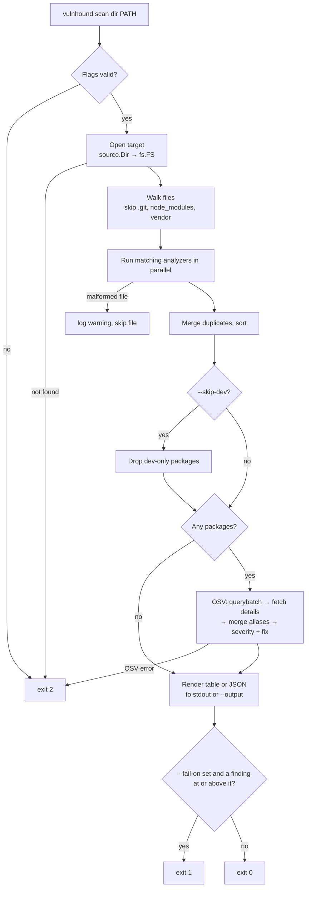
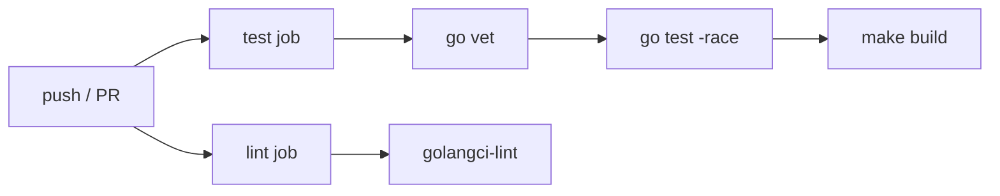
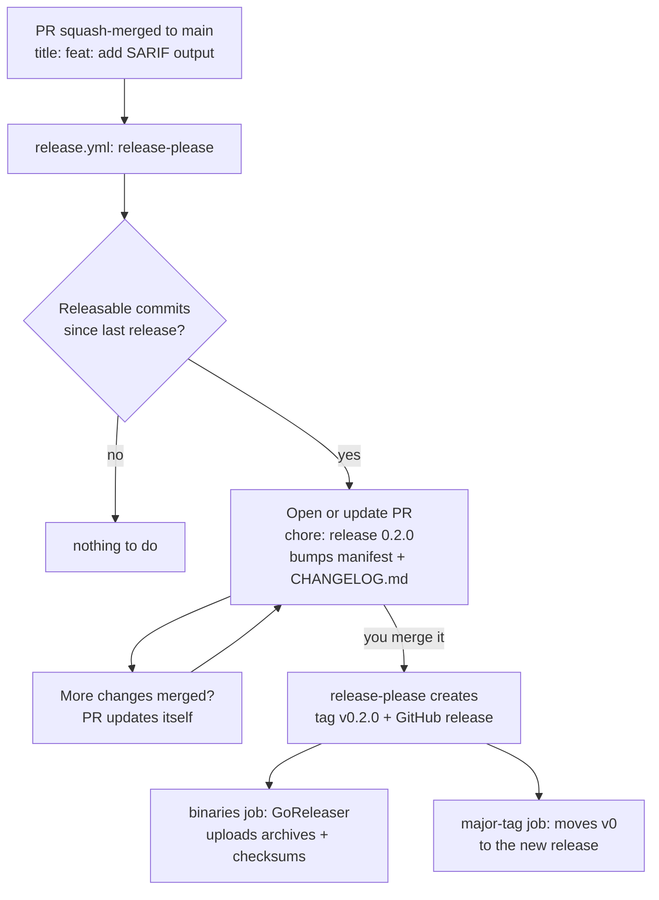
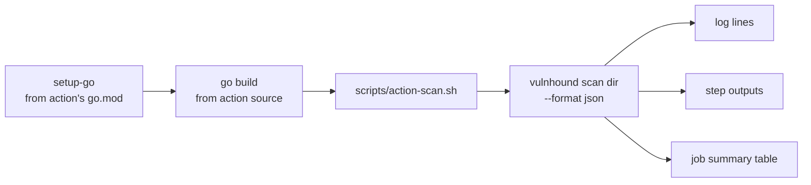

# Workflow

This document covers three workflows:

1. [Scan workflow](#1-scan-workflow): what happens when you run
   `vulnhound scan dir`.
2. [Development workflow](#2-development-workflow): how to build, test, and
   extend vulnhound.
3. [CI/CD workflow](#3-cicd-workflow): how vulnhound is checked and released,
   and how to use it in your own pipeline.

For the component design behind these, see [architecture.md](architecture.md).

---

## 1. Scan workflow



### Step by step

| # | Step | Code | Notes |
|---|------|------|-------|
| 1 | Parse and validate flags | `cmd/vulnhound/scan.go` `runScan` | Unknown `--format` or `--fail-on` exits 2 before any I/O |
| 2 | Open target | `source.Dir.Open` | Resolves to an absolute path; must be a directory |
| 3 | Walk | `analyzer.Catalog` phase 1 | Builds a list of (analyzer, file) jobs |
| 4 | Analyze | `analyzer.Catalog` phase 2 | Parallel; one bad file only produces a warning |
| 5 | Deduplicate | `analyzer.dedupe` | Merge by ecosystem + name + version, union locations |
| 6 | Filter | `scan.Run` | `--skip-dev` drops packages that are dev-only everywhere |
| 7 | Match | `matcher.OSV.Match` | Skipped when there are no packages |
| 8 | Report | `report.Write` | Grouped by package; colors per `--color` and `VULNHOUND_COLORS` |
| 9 | Apply policy | `runScan` | `--fail-on` returns `errFindings` → exit 1 |

### Debugging a scan

```bash
vulnhound scan dir . -v
```

`-v` turns on debug logging (to stderr, so it never corrupts JSON on stdout).
It shows each analyzed file and its package count, how long cataloging and
matching took, and any OSV retries.

Common questions:

| Symptom | Likely cause |
|---------|-------------|
| `Packages: 0` | No `go.mod` or `package-lock.json` outside skipped dirs. `yarn.lock`, `pnpm-lock.yaml`, and `go.sum` are not read. |
| A dependency is missing | Its version is not from a registry (`git+…`, `file:…`), or it is a local `replace` in `go.mod`. |
| Severity `UNKNOWN` | The OSV record has no CVSS v3 vector and no advisory rating. Common for `GO-` IDs. |
| `FIXED IN` lists several versions | The installed version is not in any range the tool could compare; all fixes are listed. |
| `FIXED IN` is `-` | OSV knows of no fix yet. |
| Exit 2 with `osv querybatch` | No network access to `api.osv.dev`, or the API rejected the request. |

---

## 2. Development workflow

### Setup

Requirements: Go 1.26+ and, optionally,
[golangci-lint](https://golangci-lint.run) v2.

```bash
git clone https://github.com/0x48core/vulnhound
cd vulnhound
go mod download
make build && ./bin/vulnhound version
```

> **Corporate proxy note.** If your `GOPROXY` points at an internal proxy
> that is unreachable, `go mod download` fails with a timeout. Modules
> already in your local cache can be used offline with `GOPROXY=off`.

### Make targets

| Command | What it does |
|---------|-------------|
| `make build` | Static binary at `bin/vulnhound` (`CGO_ENABLED=0`, version from `git describe`) |
| `make test` | `go test -race ./...` |
| `make lint` | `golangci-lint run ./...` using `.golangci.yml` |
| `make fmt` | `gofmt` + `goimports` with local imports grouped last |
| `make clean` | Remove `bin/` |

Run `make lint test` before every commit. CI runs the same checks.

### Testing strategy

Tests never touch the real network or depend on what is installed on the
machine.

| Layer | How it is tested | Where |
|-------|------------------|-------|
| Analyzers | Real-format lockfile fixtures, assertions on name/version/direct/dev and PURL | `internal/analyzer/testdata/`, `analyzer_test.go` |
| Catalog | In-memory `fstest.MapFS`: dedupe, skipped dirs, broken files | `analyzer_test.go` |
| CVSS | Reference vectors with known scores from the CVSS calculator | `internal/matcher/osv_test.go` |
| OSV matcher | `httptest.Server` that mimics OSV: pagination, aliases, withdrawn records, HTTP errors | `osv_test.go` |
| CLI end to end | Builds the root command, points `--osv-url` at a fake server, checks table, JSON, `--skip-dev`, and `--fail-on` | `cmd/vulnhound/scan_test.go` |

To check against the real API manually:

```bash
make build
./bin/vulnhound scan dir internal/analyzer/testdata
```

The fixtures pin old versions (lodash 4.17.15, minimist 1.2.0, gin 1.9.0), so
this should always report findings, including at least one CRITICAL.

### Recipe: adding an ecosystem

Using Cargo (`Cargo.lock`) as an example:

1. **Fixture.** Add a real `Cargo.lock` under
   `internal/analyzer/testdata/cargo/`, ideally with a known-vulnerable
   crate.
2. **Analyzer.** Create `internal/analyzer/cargo.go`:
   - `Match`: `path.Base(p) == "Cargo.lock"`.
   - `Analyze`: parse it and return packages with `Ecosystem: "crates.io"`
     (the OSV name) and `PURL: purl.Build("cargo", name, version)`.
3. **Register.** Add `CargoLock{}` to `analyzer.Default()` in `analyzer.go`.
4. **Ecosystem constant.** Add `EcosystemCargo = "crates.io"` to
   `pkg/types/types.go`.
5. **Version comparison.** Cargo uses semver, so add it to the `case` in
   `canonical` (`internal/matcher/osv.go`) to get precise `FixedIn` values.
   For non-semver ecosystems, add a dedicated comparator instead.
6. **Test.** Add a `TestCargoLock` table test next to the npm ones.
7. **Docs.** Update the supported-files table in `README.md` and the
   analyzer table in `docs/architecture.md`.
8. Run `make lint test`, then scan the fixture against the real API.

### Recipe: adding a scan target

1. Implement `source.Source` in `internal/source/` and return a `Target`
   with an `fs.FS` and a `closer` that removes temp data.
2. Add `newScan<Type>Cmd()` in `cmd/vulnhound/scan.go` that builds the source
   and calls `runScan`. Reuse the same flag set.
3. Test the source with a small local fixture (for images, build one in the
   test with go-containerregistry's `random` and `mutate` packages rather
   than pulling from a registry).

### Code conventions

- Keep stage boundaries clean: analyzers know nothing about OSV, and the
  matcher knows nothing about files.
- Return errors with context (`fmt.Errorf("open target: %w", err)`); log only
  at the point where an error is deliberately downgraded to a warning.
- Logs go to stderr through `log/slog`; reports go to stdout or `--output`.
- Anything that ends up in output must be sorted.
- New exported identifiers in `pkg/types` are public API: change them with
  care.

### Git workflow

1. Branch from `main`: `feat/<topic>`, `fix/<topic>`, or `docs/<topic>`.
2. Open a pull request whose title is a
   [Conventional Commit](https://www.conventionalcommits.org):
   `feat: add Cargo.lock analyzer`, `fix(npm): handle workspace links`.
   The `PR title` check (`.github/workflows/pr-title.yml`) enforces this,
   including a lowercase subject.
3. CI must pass before merging.
4. **Squash-merge.** The PR title becomes the commit message on `main`,
   which is what drives the version bump and the changelog entry (see
   [Releases](#releases)). Commit messages inside the branch don't matter.

---

## 3. CI/CD workflow

### Continuous integration

`.github/workflows/ci.yml` runs on every push to `main` and on every pull
request:



Both jobs use the Go version from `go.mod` and run in parallel.

### Dependency updates

Two bots keep dependencies current. Each owns one ecosystem, so they never
open duplicate pull requests for the same dependency.

| Bot | Config | Updates | Schedule |
|-----|--------|---------|----------|
| [Renovate](https://docs.renovatebot.com) | `renovate.json` | Go modules (`go.mod`, `go.sum`) | Mondays before 06:00 (Asia/Ho_Chi_Minh) |
| [Dependabot](https://docs.github.com/code-security/dependabot) | `.github/dependabot.yml` | GitHub Actions in `.github/workflows/` | Mondays 06:00 (Asia/Ho_Chi_Minh), all actions grouped into one PR |

Renovate is used for Go because it runs `go mod tidy` after each update and
groups the `golang.org/x/*` modules into a single PR.

Shared policies:

- **3-day release-age wait.** A new version must have been published for 3
  days before a PR opens (`minimumReleaseAge` in Renovate, `cooldown` in
  Dependabot). This avoids picking up a compromised or quickly yanked
  release.
- **Security fixes skip the schedule and the wait.** Renovate opens them as
  soon as a vulnerability is known, using both GitHub alerts and
  OSV (`osvVulnerabilityAlerts`), and labels them `security`.
- **The `go` directive is not bumped automatically.** It is the minimum Go
  version vulnhound supports, so raising it is a deliberate decision.
- **Indirect Go modules are not updated on their own.** This is Renovate's
  default; they move when a direct dependency that needs them is updated.
- Nothing auto-merges. Every update goes through CI and review.

One-time setup on GitHub:

1. Install the [Renovate GitHub App](https://github.com/apps/renovate) on the
   repository. Its first PR is an onboarding check; because `renovate.json`
   already exists, it only confirms the config. Renovate also maintains a
   "Dependency Dashboard" issue listing pending updates.
2. Dependabot version updates start automatically once
   `.github/dependabot.yml` is on the default branch.
3. Optionally enable **Dependabot alerts** under *Settings → Code security*.
   Leave **Dependabot security updates** off, because Renovate already opens
   security PRs for Go modules.

### Releases

Releases are automated with
[release-please](https://github.com/googleapis/release-please). Nobody
creates tags or edits `CHANGELOG.md` by hand.



1. **Every push to `main`** runs `.github/workflows/release.yml`.
   release-please reads the Conventional Commits since the last release.
2. If any are **releasable**, it opens a pull request titled
   `chore: release X.Y.Z` (or updates the one already open). The PR bumps
   `.release-please-manifest.json` and adds the new section to
   `CHANGELOG.md`. Review the PR to see exactly what the release contains.
3. **Merging that PR is the release.** release-please creates the `vX.Y.Z`
   tag and a GitHub release whose notes are the new changelog section.
4. In the same workflow run:
   - **binaries**: [GoReleaser](https://goreleaser.com) (`.goreleaser.yaml`)
     builds static binaries for Linux, macOS, and Windows on amd64 and
     arm64, and uploads `.tar.gz`/`.zip` archives and `checksums.txt` to
     the release. Binaries report the tag in `vulnhound version`.
   - **major-tag**: moves `v0` (later `v1`, …) to the new release, so
     action users pinned to `@v0` get it automatically.

These steps run in one workflow because tags and releases created with
`GITHUB_TOKEN` do not trigger other workflows.

#### How the version is chosen

| Commits since last release | Before 1.0.0 | From 1.0.0 |
|---|---|---|
| `fix:`, `perf:`, `deps:`, `revert:` | patch (0.1.0 → 0.1.1) | patch (1.2.0 → 1.2.1) |
| `feat:` | minor (0.1.0 → 0.2.0) | minor (1.2.0 → 1.3.0) |
| `feat!:` or a `BREAKING CHANGE:` footer | minor (0.1.0 → 0.2.0) | major (1.2.0 → 2.0.0) |
| only `docs:`, `ci:`, `chore:`, `test:`, `refactor:`, `build:`, `style:` | no release | no release |

Before 1.0.0, breaking changes bump the minor version
(`bump-minor-pre-major`). To release a specific version, for example the
first `1.0.0`, add a footer to any commit merged to `main`:

```
Release-As: 1.0.0
```

#### Commit types and the changelog

| Type | Use for | In CHANGELOG.md |
|------|---------|-----------------|
| `feat` | New user-facing behaviour | Features |
| `fix` | Bug fixes | Bug Fixes |
| `perf` | Performance improvements | Performance |
| `deps` | Dependency updates (Renovate uses `deps(go):`) | Dependencies |
| `revert` | Reverting an earlier commit | Reverts |
| `docs`, `refactor`, `test`, `build`, `ci`, `chore`, `style` | Documentation and internal changes | hidden |

Dependabot's GitHub Actions updates use `ci:`, so they never trigger a
release on their own.

#### One-time GitHub setup

1. *Settings → Actions → General → Workflow permissions*: enable **Allow
   GitHub Actions to create and approve pull requests**. release-please
   cannot open its PR without it.
2. *Settings → General → Pull Requests*: allow **squash merging** only, with
   the default commit message set to **Pull request title**. With merge
   commits, release-please would read every commit on the branch instead of
   the checked PR title.
3. *Recommended:* create a fine-grained token or GitHub App token with
   *Contents* and *Pull requests* write access and save it as the
   `RELEASE_PLEASE_TOKEN` secret. Pull requests opened with the default
   `GITHUB_TOKEN` do not trigger workflows, so without it CI does not run on
   the release PR. If branch protection requires CI checks, you will not be
   able to merge the release PR without this token.

### Using vulnhound in your own pipeline

The repository root is a GitHub Action (`action.yml`), so other repositories
can use it with `uses: 0x48core/vulnhound@<ref>`.

```yaml
# .github/workflows/vulnhound.yml
name: Dependency scan
on: [pull_request]

permissions:
  contents: read

jobs:
  scan:
    runs-on: ubuntu-latest
    steps:
      - uses: actions/checkout@v4
      - id: vulnhound
        uses: 0x48core/vulnhound@main # use @v0 once the first release (v0.1.0) is published
        with:
          fail-on: high
          skip-dev: true
      - if: always() && steps.vulnhound.outputs.report != ''
        uses: actions/upload-artifact@v4
        with:
          name: vulnhound-report
          path: ${{ steps.vulnhound.outputs.report }}
```

| Goal | Input |
|------|-------|
| Block merges on serious issues | `fail-on: high` |
| Ignore test-only tooling | `skip-dev: true` |
| Scan one service in a monorepo | `path: services/api` |
| Reuse the job's existing Go | `setup-go: false` |
| Keep a machine-readable record | Upload `steps.<id>.outputs.report` as an artifact |

The step fails with exit code 1 when `fail-on` is exceeded, and with exit
code 2 when the scan itself failed (for example OSV was unreachable).
Outputs and the job summary are still written when the policy fails, so
`if: always()` steps can use them.

#### How the action works



1. **Set up Go** (skipped with `setup-go: false`) using the Go version in
   the action's own `go.mod`.
2. **Build** vulnhound from the action's checkout (`$GITHUB_ACTION_PATH`).
   The binary therefore always matches the ref the caller pinned, and its
   version is set to that ref. The build directory is added to `PATH`, so
   later steps can run `vulnhound` directly.
3. **Scan** once with JSON output (`scripts/action-scan.sh`). The log lines,
   the `findings` and `report` outputs, and the Markdown job summary are all
   derived from that one report. Inputs reach the script as environment
   variables, never interpolated into shell code, so they cannot inject
   commands.

`.github/workflows/action-test.yml` runs the action from this checkout
(`uses: ./`) on Linux, macOS, and Windows for every change that affects it.
It checks a vulnerable scan, a `fail-on` failure with outputs still set,
`setup-go: false`, and an empty project.

#### Versioning the action

Every release creates an exact tag (`v0.2.1`) and moves the major tag
(`v0`, later `v1`) to it automatically (see [Releases](#releases)).

| Pin | Gets |
|-----|------|
| `@v0` / `@v1` | Every release in that major version |
| `@v0.2.1` | Exactly that release |
| `@<commit SHA>` | Exactly that commit, safest against tag tampering; Dependabot keeps SHA pins up to date |
| `@main` | Unreleased code; avoid outside testing |

To list the action on the GitHub Marketplace, edit a GitHub release created
by release-please and tick "Publish this Action to the GitHub Marketplace".
