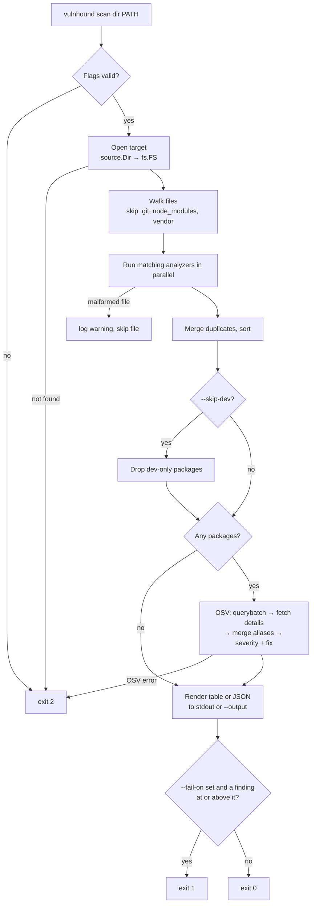
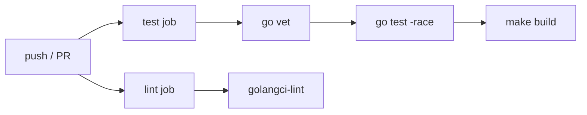
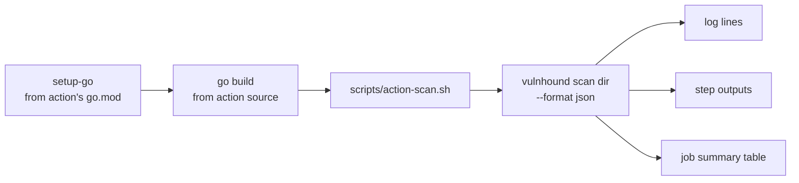

# Workflow

This document covers three workflows:

1. [Scan workflow](#1-scan-workflow): what happens when you run
   `vulnhound scan dir`.
2. [Development workflow](#2-development-workflow): how to build, test, and
   extend vulnhound.
3. [CI/CD workflow](#3-cicd-workflow): how vulnhound is checked and released,
   and how to use it in your own pipeline.

For the component design behind these, see [architecture.md](architecture.md).

---

## 1. Scan workflow



### Step by step

| # | Step | Code | Notes |
|---|------|------|-------|
| 1 | Parse and validate flags | `cmd/vulnhound/scan.go` `runScan` | Unknown `--format` or `--fail-on` exits 2 before any I/O |
| 2 | Open target | `source.Dir.Open` | Resolves to an absolute path; must be a directory |
| 3 | Walk | `analyzer.Catalog` phase 1 | Builds a list of (analyzer, file) jobs |
| 4 | Analyze | `analyzer.Catalog` phase 2 | Parallel; one bad file only produces a warning |
| 5 | Deduplicate | `analyzer.dedupe` | Merge by ecosystem + name + version, union locations |
| 6 | Filter | `scan.Run` | `--skip-dev` drops packages that are dev-only everywhere |
| 7 | Match | `matcher.OSV.Match` | Skipped when there are no packages |
| 8 | Report | `report.Write` | Colors only on a terminal |
| 9 | Apply policy | `runScan` | `--fail-on` returns `errFindings` → exit 1 |

### Debugging a scan

```bash
vulnhound scan dir . -v
```

`-v` turns on debug logging (to stderr, so it never corrupts JSON on stdout).
It shows each analyzed file and its package count, how long cataloging and
matching took, and any OSV retries.

Common questions:

| Symptom | Likely cause |
|---------|-------------|
| `Packages: 0` | No `go.mod` or `package-lock.json` outside skipped dirs. `yarn.lock`, `pnpm-lock.yaml`, and `go.sum` are not read. |
| A dependency is missing | Its version is not from a registry (`git+…`, `file:…`), or it is a local `replace` in `go.mod`. |
| Severity `UNKNOWN` | The OSV record has no CVSS v3 vector and no advisory rating. Common for `GO-` IDs. |
| `FIXED IN` lists several versions | The installed version is not in any range the tool could compare; all fixes are listed. |
| `FIXED IN` is `-` | OSV knows of no fix yet. |
| Exit 2 with `osv querybatch` | No network access to `api.osv.dev`, or the API rejected the request. |

---

## 2. Development workflow

### Setup

Requirements: Go 1.26+ and, optionally,
[golangci-lint](https://golangci-lint.run) v2.

```bash
git clone https://github.com/0x48core/vulnhound
cd vulnhound
go mod download
make build && ./bin/vulnhound version
```

> **Corporate proxy note.** If your `GOPROXY` points at an internal proxy
> that is unreachable, `go mod download` fails with a timeout. Modules
> already in your local cache can be used offline with `GOPROXY=off`.

### Make targets

| Command | What it does |
|---------|-------------|
| `make build` | Static binary at `bin/vulnhound` (`CGO_ENABLED=0`, version from `git describe`) |
| `make test` | `go test -race ./...` |
| `make lint` | `golangci-lint run ./...` using `.golangci.yml` |
| `make fmt` | `gofmt` + `goimports` with local imports grouped last |
| `make clean` | Remove `bin/` |

Run `make lint test` before every commit. CI runs the same checks.

### Testing strategy

Tests never touch the real network or depend on what is installed on the
machine.

| Layer | How it is tested | Where |
|-------|------------------|-------|
| Analyzers | Real-format lockfile fixtures, assertions on name/version/direct/dev and PURL | `internal/analyzer/testdata/`, `analyzer_test.go` |
| Catalog | In-memory `fstest.MapFS`: dedupe, skipped dirs, broken files | `analyzer_test.go` |
| CVSS | Reference vectors with known scores from the CVSS calculator | `internal/matcher/osv_test.go` |
| OSV matcher | `httptest.Server` that mimics OSV: pagination, aliases, withdrawn records, HTTP errors | `osv_test.go` |
| CLI end to end | Builds the root command, points `--osv-url` at a fake server, checks table, JSON, `--skip-dev`, and `--fail-on` | `cmd/vulnhound/scan_test.go` |

To check against the real API manually:

```bash
make build
./bin/vulnhound scan dir internal/analyzer/testdata
```

The fixtures pin old versions (lodash 4.17.15, minimist 1.2.0, gin 1.9.0), so
this should always report findings, including at least one CRITICAL.

### Recipe: adding an ecosystem

Using Cargo (`Cargo.lock`) as an example:

1. **Fixture.** Add a real `Cargo.lock` under
   `internal/analyzer/testdata/cargo/`, ideally with a known-vulnerable
   crate.
2. **Analyzer.** Create `internal/analyzer/cargo.go`:
   - `Match`: `path.Base(p) == "Cargo.lock"`.
   - `Analyze`: parse it and return packages with `Ecosystem: "crates.io"`
     (the OSV name) and `PURL: purl.Build("cargo", name, version)`.
3. **Register.** Add `CargoLock{}` to `analyzer.Default()` in `analyzer.go`.
4. **Ecosystem constant.** Add `EcosystemCargo = "crates.io"` to
   `pkg/types/types.go`.
5. **Version comparison.** Cargo uses semver, so add it to the `case` in
   `canonical` (`internal/matcher/osv.go`) to get precise `FixedIn` values.
   For non-semver ecosystems, add a dedicated comparator instead.
6. **Test.** Add a `TestCargoLock` table test next to the npm ones.
7. **Docs.** Update the supported-files table in `README.md` and the
   analyzer table in `docs/architecture.md`.
8. Run `make lint test`, then scan the fixture against the real API.

### Recipe: adding a scan target

1. Implement `source.Source` in `internal/source/` and return a `Target`
   with an `fs.FS` and a `closer` that removes temp data.
2. Add `newScan<Type>Cmd()` in `cmd/vulnhound/scan.go` that builds the source
   and calls `runScan`. Reuse the same flag set.
3. Test the source with a small local fixture (for images, build one in the
   test with go-containerregistry's `random` and `mutate` packages rather
   than pulling from a registry).

### Code conventions

- Keep stage boundaries clean: analyzers know nothing about OSV, and the
  matcher knows nothing about files.
- Return errors with context (`fmt.Errorf("open target: %w", err)`); log only
  at the point where an error is deliberately downgraded to a warning.
- Logs go to stderr through `log/slog`; reports go to stdout or `--output`.
- Anything that ends up in output must be sorted.
- New exported identifiers in `pkg/types` are public API: change them with
  care.

### Git workflow

1. Branch from `main`: `feat/<topic>`, `fix/<topic>`, or `docs/<topic>`.
2. Keep commits focused; use imperative subjects (`Add Cargo.lock analyzer`).
3. Open a pull request. CI must pass before merging.
4. Squash-merge to keep `main` linear.

---

## 3. CI/CD workflow

### Continuous integration

`.github/workflows/ci.yml` runs on every push to `main` and on every pull
request:



Both jobs use the Go version from `go.mod` and run in parallel.

### Releases (planned)

Releases are not automated yet. The intended flow:

1. Tag `main`: `git tag v0.1.0 && git push --tags`.
2. A release workflow runs [GoReleaser](https://goreleaser.com), which builds
   static binaries for Linux, macOS, and Windows (amd64/arm64), creates a
   GitHub release with checksums, and publishes a container image.
3. `make build` already injects the version with
   `-ldflags "-X main.version=…"`, so released binaries report it in
   `vulnhound version`.

### Using vulnhound in your own pipeline

The repository root is a GitHub Action (`action.yml`), so other repositories
can use it with `uses: 0x48core/vulnhound@<ref>`.

```yaml
# .github/workflows/vulnhound.yml
name: Dependency scan
on: [pull_request]

permissions:
  contents: read

jobs:
  scan:
    runs-on: ubuntu-latest
    steps:
      - uses: actions/checkout@v4
      - id: vulnhound
        uses: 0x48core/vulnhound@main # pin a release tag or commit SHA once available
        with:
          fail-on: high
          skip-dev: true
      - if: always() && steps.vulnhound.outputs.report != ''
        uses: actions/upload-artifact@v4
        with:
          name: vulnhound-report
          path: ${{ steps.vulnhound.outputs.report }}
```

| Goal | Input |
|------|-------|
| Block merges on serious issues | `fail-on: high` |
| Ignore test-only tooling | `skip-dev: true` |
| Scan one service in a monorepo | `path: services/api` |
| Reuse the job's existing Go | `setup-go: false` |
| Keep a machine-readable record | Upload `steps.<id>.outputs.report` as an artifact |

The step fails with exit code 1 when `fail-on` is exceeded, and with exit
code 2 when the scan itself failed (for example OSV was unreachable).
Outputs and the job summary are still written when the policy fails, so
`if: always()` steps can use them.

#### How the action works



1. **Set up Go** (skipped with `setup-go: false`) using the Go version in
   the action's own `go.mod`.
2. **Build** vulnhound from the action's checkout (`$GITHUB_ACTION_PATH`).
   The binary therefore always matches the ref the caller pinned, and its
   version is set to that ref. The build directory is added to `PATH`, so
   later steps can run `vulnhound` directly.
3. **Scan** once with JSON output (`scripts/action-scan.sh`). The log lines,
   the `findings` and `report` outputs, and the Markdown job summary are all
   derived from that one report. Inputs reach the script as environment
   variables, never interpolated into shell code, so they cannot inject
   commands.

`.github/workflows/action-test.yml` runs the action from this checkout
(`uses: ./`) on Linux, macOS, and Windows for every change that affects it.
It checks a vulnerable scan, a `fail-on` failure with outputs still set,
`setup-go: false`, and an empty project.

#### Versioning the action

Until the first release, consumers use `@main`. When releases start:

1. Tag the release (`v1.0.0`) and move a major tag (`v1`) to the same
   commit, so `@v1` users get fixes and features without breaking changes.
2. Security-sensitive consumers can pin the full commit SHA instead;
   Dependabot keeps SHA pins up to date.
3. To list the action on the GitHub Marketplace, tick "Publish this Action
   to the GitHub Marketplace" when creating the GitHub release.
